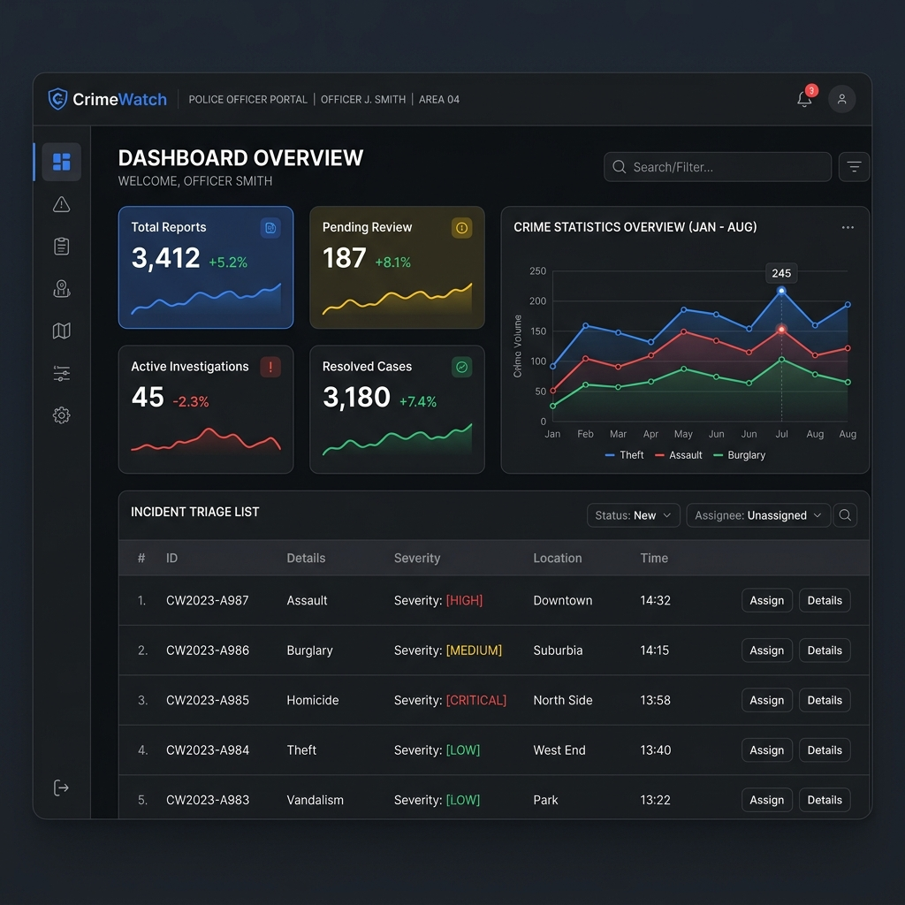
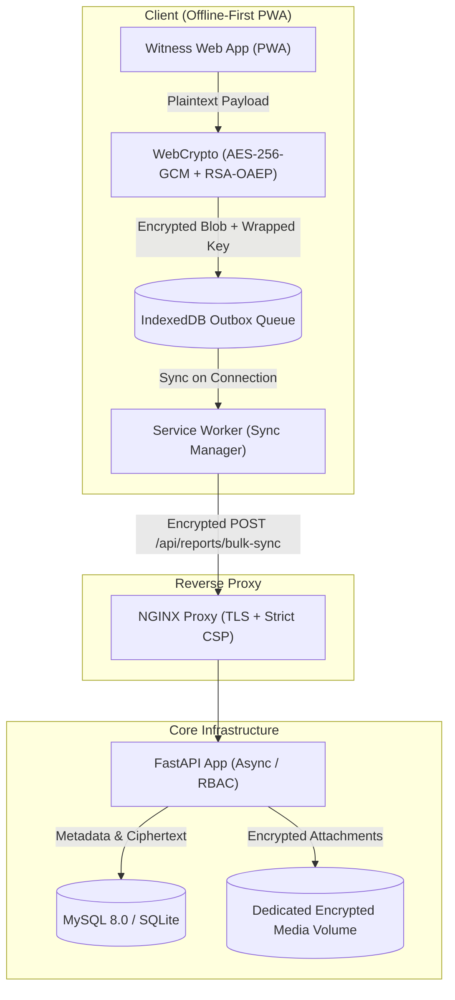
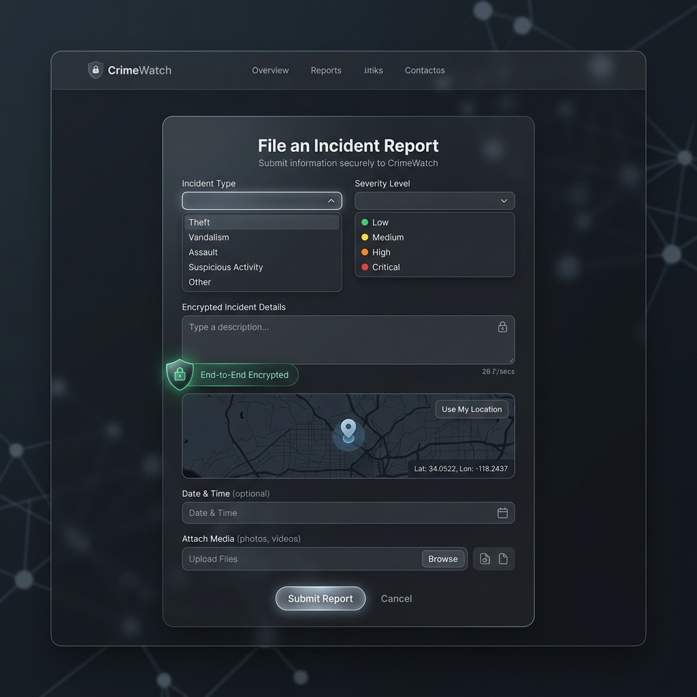
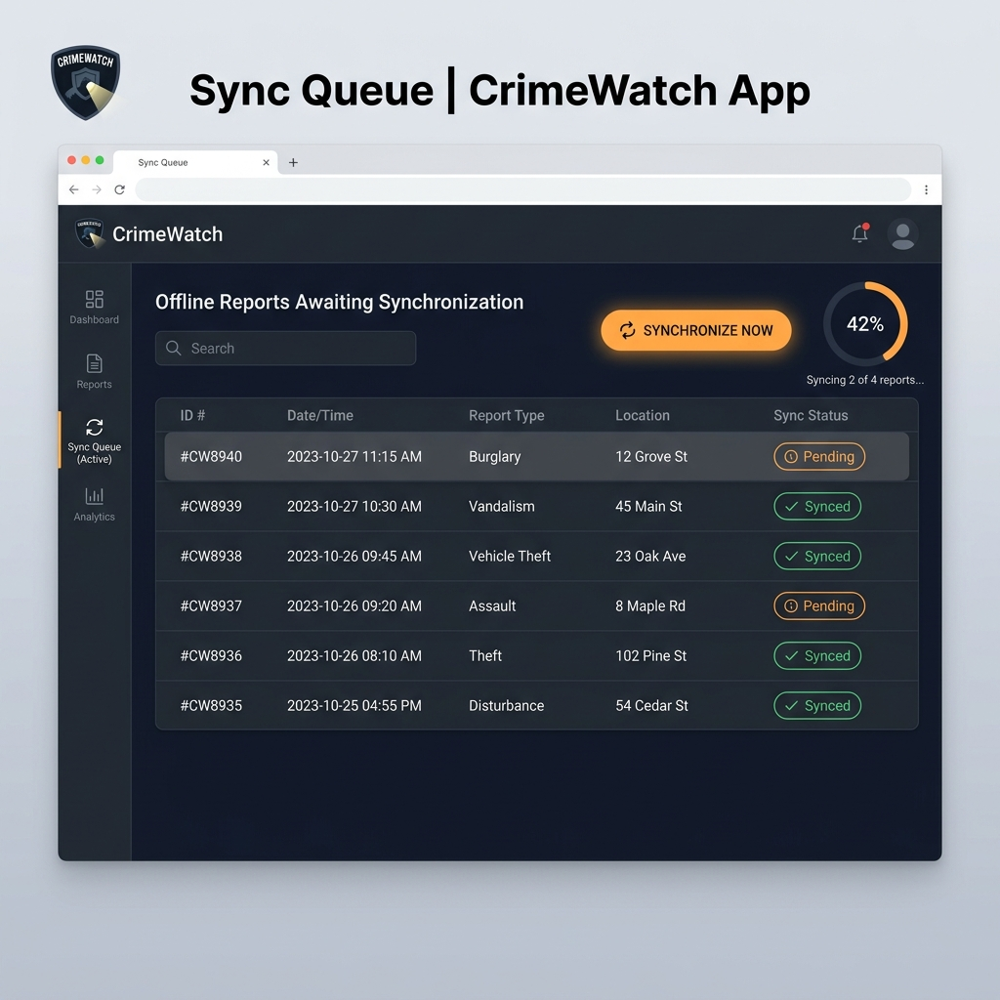
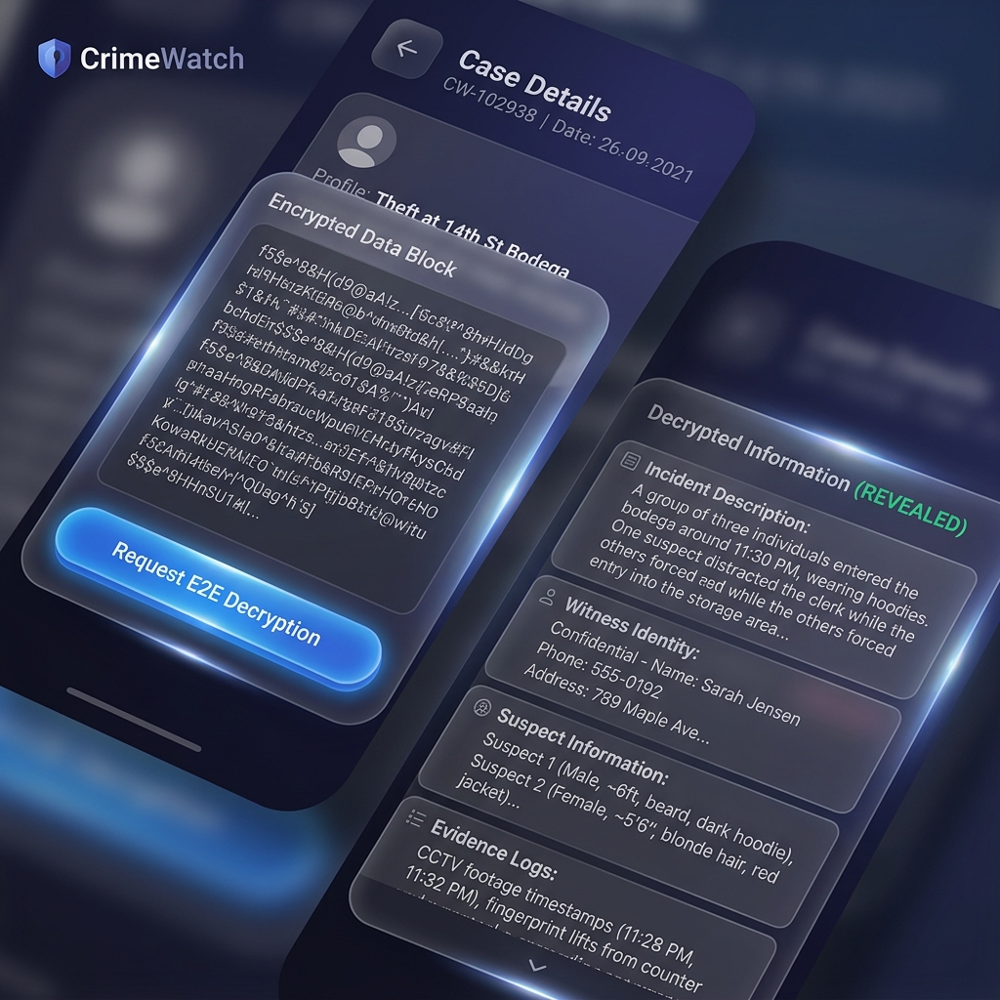

# CrimeWatch

An offline-first, end-to-end encrypted incident reporting platform built for high-risk public safety and witness protection in low-connectivity environments.

**Status:** Production-Ready MVP · **Stack:** FastAPI, Vanilla JS (PWA / WebCrypto), MySQL 8.0, NGINX, Docker



## The problem

In Kenya and emerging markets, citizens reporting sensitive crimes face two major barriers: fear of surveillance or retaliation, and erratic mobile internet where submissions drop mid-upload. Standard web reporting systems transmit unencrypted incident data over insecure public networks and require continuous connectivity, causing lost reports and putting whistleblowers at risk of identification.

## How it works



- **Client-Side Envelope Encryption (AES-256-GCM + RSA-OAEP):** The browser generates an ephemeral 256-bit AES key via WebCrypto to encrypt incident text and evidence attachments before anything leaves the device. The AES key is wrapped with the server's RSA-2048 public key. Intercepted payloads in transit contain zero decipherable plaintext.
- **Offline Persistence via IndexedDB & Service Worker:** Reports created in dead zones or during network cuts are committed immediately to local IndexedDB. The Service Worker listens for connectivity events and flushes the outbox queue automatically via background sync with idempotency keys to prevent duplicate entries.
- **Zero-PII Metadata Segregation:** Severity levels, incident types, and coordinates are stored in separate unencrypted columns to allow real-time dispatch queries and geospatial clustering, while witness identities and narrative evidence remain encrypted ciphertext.
- **Role-Based Decryption & Access Control (RBAC):** Strict boundaries isolate `public`, `officer`, and `admin` roles. Decryption of sensitive case narratives requires authenticated officer credentials and is logged to a tamper-evident audit table.

## Trade-offs and what I'd change

- **Server-Side Key Wrapping vs. Pure Zero-Knowledge E2E:** Currently, the server holds the RSA private key to allow assigned officers to decrypt and review submissions. A pure zero-knowledge scheme would encrypt exclusively against an individual officer's public key. I chose server-managed RSA to enable reassignment, supervisor auditing, and prevent evidence loss if an officer loses their private key.
- **IndexedDB Blob Memory vs. Web Streams Chunking:** Media attachments under 50MB are buffered as binary blobs directly in IndexedDB. In low-RAM Android smartphones, encrypting multiple video files simultaneously strains browser memory. I would refactor to a streaming Web Crypto pipeline that encrypts and transmits chunks in 2MB slices.
- **Synchronous Ingestion vs. Distributed Message Broker:** The sync endpoint writes directly to the database. For normal traffic, this keeps infrastructure lightweight (no mandatory Redis/Celery dependency in dev). Under high-volume civil events, I would decouple ingestion with a Redis Streams or RabbitMQ queue to return immediate HTTP 202 ACKs and process writes asynchronously.

## Running it locally

Three commands to spin up the full stack (FastAPI, NGINX, MySQL, Redis):

```bash
git clone https://github.com/IM4-RD/crimewatch.git && cd crimewatch
bash setup.sh dev
# App: http://localhost  ·  API Docs: http://localhost:8000/api/docs
```

*Or manual backend run without Docker:*
```powershell
cd backend; .\venv\Scripts\activate; pip install -r requirements.txt; python init_db.py; python -m uvicorn main:app --port 8000
```

---

### Interface Preview

| Incident Reporting (Offline PWA) | Offline Queue & Sync Notification |
|:---:|:---:|
|  |  |

| Case Investigation & Decryption | Incident Details Modal |
|:---:|:---:|
|  |  |

