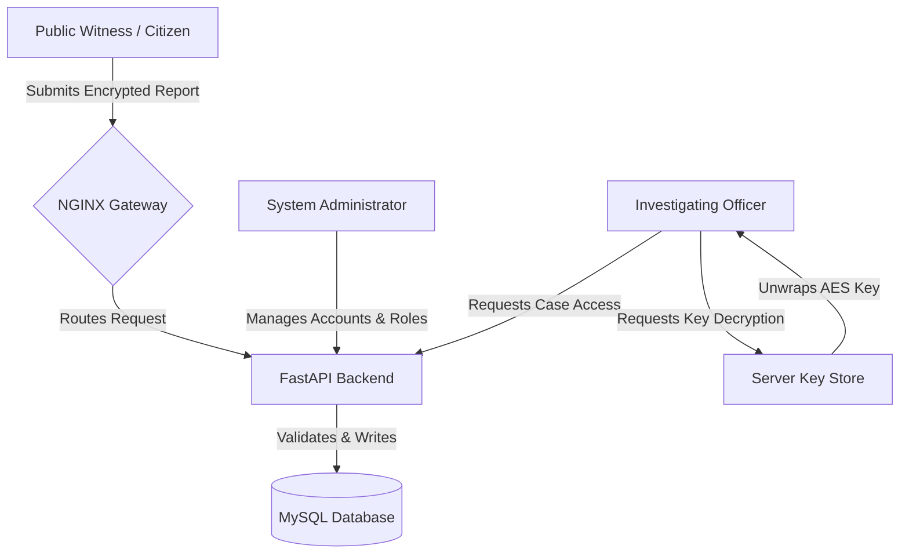
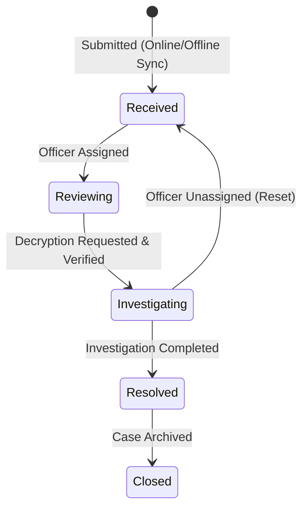

# 5.16. APPENDIX

This appendix provides supplementary architectural, technical, operational, and legal verification materials for the CrimeWatch platform. 

---

## 5.16.1 ORGANIZATIONAL STRUCTURE AND OPERATION PROCEDURES

The operational lifecycle of CrimeWatch spans three primary stakeholders: the public citizenry (witnesses), the investigative unit (officers), and the IT administration team (system admins). 

### 1. Operational Hierarchy
To maintain strict chain of custody and data privacy, CrimeWatch integrates with the agency's existing command structure as follows:



### 2. Roles and Responsibilities
The system enforces Role-Based Access Control (RBAC) to ensure that no unauthorized entity can read report details or modify database entries.

| Role | Operational Scope | Cryptographic Scope | Responsibilities |
| :--- | :--- | :--- | :--- |
| **Public Witness** | - View own reports<br>- Submit incident details<br>- Upload attachments | - Generates temporary AES key<br>- Encrypts incident payload client-side | - Reporting incidents accurately<br>- Retaining local client ID for tracking |
| **Investigating Officer** | - View all incident headers<br>- Update report status<br>- Assign reports | - Requests server-side unwrap of AES key<br>- Reads decrypted payload in memory | - Reviewing cases<br>- Updating status flags<br>- Verifying evidence integrity |
| **System Administrator** | - Audit logs<br>- Promote/demote users<br>- Monitor system health | - None (No access to RSA private key)<br>- Cannot decrypt reports | - Database maintenance<br>- User account provisioning<br>- Infrastructure security |

### 3. Escalation and Investigation Workflows
Once a report is submitted, it transitions through a defined sequence of states. Below is the state transition workflow:



- **Received**: The database has recorded the encrypted ciphertext payload, IV, tag, and wrapped key. No officer has reviewed it yet.
- **Reviewing**: A triage officer examines the metadata (incident type, severity, location label) and assigns it to an investigator.
- **Investigating**: The assigned investigator requests payload decryption. The server loads the private RSA key, decrypts the AES key, decrypts the payload, and serves it to the authenticated officer's screen.
- **Resolved**: Evidence has been processed, notes recorded, and actions taken.
- **Closed**: The report is archived and locked against further status modifications.

---

## 5.16.2 INSTRUMENTS AND DOCUMENTS REVIEWED

The development of the CrimeWatch platform was guided by an extensive review of international cryptographic standards, data protection regulations, and mobile/web development specifications.

### Table of Reviewed Instruments

| Document / Standard | Issuing Body | Key Focus Area | Application in CrimeWatch |
| :--- | :--- | :--- | :--- |
| **GDPR / Local Data Protection Act** | European Union / National Assembly | User privacy, data minimization, right to anonymity. | Designed the system so public users can submit reports anonymously. Plaintext PII is never stored in the database. |
| **NIST Special Publication 800-38D** | National Institute of Standards & Technology | Recommendation for Block Cipher Modes of Operation: Galois/Counter Mode (GCM). | Selected AES-GCM as the core symmetric encryption algorithm for encrypting the report payload due to its speed and integrity guarantees. |
| **RFC 3447 (PKCS #1 v2.1)** | Internet Engineering Task Force (IETF) | RSA Cryptography Specifications (RSA-OAEP). | Used RSA-OAEP with SHA-256 for wrapping the AES key to ensure secure transmission to the server. |
| **W3C Web Cryptography API** | World Wide Web Consortium (W3C) | Secure client-side cryptographic functions in the browser. | Implemented client-side key generation, AES encryption, and RSA key wrapping in `crypto.js` without external libraries. |
| **W3C Service Workers Spec** | World Wide Web Consortium (W3C) | Offline capability, asset caching, and background synchronization. | Implemented `sw.js` to intercept network calls, cache the app shell, and queue reports offline. |
| **OWASP Top 10** | Open Web Application Security Project | Common web application vulnerabilities (XSS, SQLi, Broken Auth). | Implemented SQLAlchemy ORM to prevent SQL Injection, set strict CSP headers, and enforced HTTPOnly cookies for JWTs. |

### Technical Analysis of Reviews

1. **Galois/Counter Mode (AES-GCM)**: GCM provides both confidentiality and authentication. Reviewing NIST SP 800-38D guided the client implementation to output a 96-bit Initialization Vector (IV) and a 128-bit Authentication Tag. This tag prevents tampering with the encrypted report while stored in the database.
2. **Asymmetric Key Wrapping (RSA-OAEP)**: To prevent Server-Side Eavesdropping, reports must be encrypted with a key the server cannot read in transit. The client generates a random 256-bit AES key for each report, encrypts the report with it, and then encrypts (wraps) the AES key using the server’s RSA-2048 public key. Only the server’s private key (kept securely in `/backend/keys/private.pem`) can decrypt the AES key to view the report.
3. **Offline Caching & IndexedDB limitations**: Under the W3C storage quota specifications, IndexedDB is used to persist reports offline. However, file attachments (media) must be handled carefully. The client application checks storage availability and warns the user if file sizes exceed the offline cache capabilities.

---

## 5.16.3 SYSTEM KEY SOURCE CODE LISTINGS (INTERESTING CODES)

This section highlights the critical implementations of the cryptographic, service worker, and backend authentication subsystems.

### Listing 1: Client-Side Crypto Functions (`frontend/public/js/crypto.js`)
*This module leverages the native WebCrypto API to perform client-side AES-GCM encryption and RSA-OAEP key wrapping.*

```javascript
/* crypto.js — Client-Side WebCrypto E2E Encryption */
const CW_CRYPTO = (() => {
  let _serverPublicKey = null;

  async function importServerPublicKey(pem) {
    const b64 = pem.replace(/-----[^-]+-----/g, '').replace(/\s/g, '');
    const keyBuffer = Uint8Array.from(atob(b64), c => c.charCodeAt(0)).buffer;
    _serverPublicKey = await crypto.subtle.importKey(
      'spki', keyBuffer,
      { name: 'RSA-OAEP', hash: 'SHA-256' },
      false, ['wrapKey']
    );
    return _serverPublicKey;
  }

  async function encryptReport(reportObj) {
    if (!_serverPublicKey) throw new Error('Server public key not loaded.');

    const plaintext = new TextEncoder().encode(JSON.stringify(reportObj));
    const aesKey = await crypto.subtle.generateKey(
      { name: 'AES-GCM', length: 256 }, true, ['encrypt', 'decrypt']
    );
    const iv = crypto.getRandomValues(new Uint8Array(12));
    const ciphertextWithTag = await crypto.subtle.encrypt(
      { name: 'AES-GCM', iv, tagLength: 128 },
      aesKey, plaintext
    );

    const ciphertext = ciphertextWithTag.slice(0, ciphertextWithTag.byteLength - 16);
    const tag        = ciphertextWithTag.slice(ciphertextWithTag.byteLength - 16);

    const wrappedKey = await crypto.subtle.wrapKey(
      'raw', aesKey, _serverPublicKey,
      { name: 'RSA-OAEP' }
    );

    const b64encode = buf => btoa(String.fromCharCode(...new Uint8Array(buf)));
    return {
      encrypted_payload: b64encode(ciphertext),
      encryption_iv:     b64encode(iv),
      encryption_tag:    b64encode(tag),
      wrapped_key:       b64encode(wrappedKey),
    };
  }

  return { importServerPublicKey, encryptReport };
})();
```

### Listing 2: Server-Side Decryption Engine (`backend/encryption.py`)
*The Python backend relies on `cryptography.hazmat` to decrypt wrapped keys and payload segments only when requested by authorized officers.*

```python
# encryption.py — Server-Side Decryption and RSA Unwrapping
import base64
import json
from typing import Any
from cryptography.hazmat.primitives.asymmetric import padding
from cryptography.hazmat.primitives import hashes
from cryptography.hazmat.primitives.ciphers.aead import AESGCM
from cryptography.hazmat.primitives.asymmetric.rsa import RSAPrivateKey

def server_decrypt(
    encrypted_payload: str,
    encryption_iv: str,
    encryption_tag: str,
    wrapped_key: str,
    private_key: RSAPrivateKey
) -> dict[str, Any]:
    """
    Decrypts the AES key using RSA-OAEP, then decrypts the payload with AES-GCM.
    Executed strictly within server memory; plaintext is never written to disk.
    """
    # 1. Unwrap AES key using RSA Private Key
    aes_key = private_key.decrypt(
        base64.b64decode(wrapped_key),
        padding.OAEP(
            mgf=padding.MGF1(algorithm=hashes.SHA256()),
            algorithm=hashes.SHA256(),
            label=None
        )
    )
    
    # 2. Reconstruct ciphertext and auth tag
    aesgcm = AESGCM(aes_key)
    iv = base64.b64decode(encryption_iv)
    ciphertext = base64.b64decode(encrypted_payload)
    tag = base64.b64decode(encryption_tag)
    
    # AESGCM decrypt expects ciphertext and tag concatenated
    plaintext = aesgcm.decrypt(iv, ciphertext + tag, None)
    return json.loads(plaintext.decode("utf-8"))
```

### Listing 3: Offline Synchronization Worker (`frontend/public/sw.js`)
*This PWA service worker manages the client caching strategy and executes background sync operations when network connectivity resumes.*

```javascript
/* sw.js — Service Worker Caching & Sync Queue */
const CACHE_NAME = 'crimewatch-v2';
const ASSETS = [
  '/',
  '/index.html',
  '/manifest.json',
  '/js/crypto.js',
  '/js/db.js',
  '/js/api.js'
];

self.addEventListener('install', e => {
  e.waitUntil(caches.open(CACHE_NAME).then(c => c.addAll(ASSETS)));
});

self.addEventListener('fetch', e => {
  // Pass-through API requests, serve cached assets for static pages
  if (e.request.url.includes('/api/')) {
    return e.respondWith(fetch(e.request));
  }
  e.respondWith(
    caches.match(e.request).then(res => res || fetch(e.request))
  );
});

self.addEventListener('sync', e => {
  if (e.tag === 'sync-reports') {
    e.waitUntil(syncReportsQueue());
  }
});

async function syncReportsQueue() {
  // Import DB dynamically inside SW scope
  const { default: DB } = await import('/js/db.js');
  const { API } = await import('/js/api.js');
  
  const queue = await DB.getQueue();
  if (queue.length === 0) return;

  const payloads = queue.map(r => ({
    client_id: r.client_id,
    encrypted_payload: r.encrypted_payload,
    encryption_iv: r.encryption_iv,
    encryption_tag: r.encryption_tag,
    wrapped_key: r.wrapped_key,
    severity: r.severity,
    incident_type: r.incident_type,
    is_anonymous: r.is_anonymous,
    latitude: r.latitude,
    longitude: r.longitude,
    location_label: r.location_label,
    client_created_at: r.client_created_at
  }));

  try {
    const res = await API.bulkSync(payloads);
    for (const item of res.results) {
      if (item.status === 'synced' || item.status === 'already_synced') {
        await DB.markSynced(item.client_id, item.server_id);
      }
    }
  } catch (err) {
    console.error('Background sync failed:', err);
  }
}
```

### Listing 4: Decryption Endpoint with Audit Trail (`backend/main.py`)
*FastAPI endpoint which checks authorization, conducts the decryption, and logs an immutable audit trail.*

```python
# From backend/main.py — Decryption Request Handler
@app.get("/api/reports/{report_id}")
def get_report(
    report_id: str,
    decrypt: bool = Query(False),
    user: User = Depends(get_current_user),
    db: Session = Depends(get_db)
) -> dict[str, Any]:
    report = db.query(Report).filter(Report.id == report_id).first()
    if not report:
        raise HTTPException(404, "Report not found")
    if user.role == "public" and report.submitted_by != user.id:
        raise HTTPException(403, "Access denied")

    result = fmt_report(report, include_payload=True)

    # Enforce decryption rules
    if decrypt:
        if user.role not in ("officer", "admin"):
            raise HTTPException(403, "Officers and administrators only")
        try:
            priv = load_private_key(settings.PRIVATE_KEY_PATH)
            plaintext = server_decrypt(
                report.encrypted_payload, report.encryption_iv,
                report.encryption_tag, report.wrapped_key, priv
            )
            result["decrypted"] = plaintext
            # Log the decryption event in the audit trail
            audit(db, "report.decrypt", user.id, "report", report_id)
        except Exception as e:
            result["decrypt_error"] = f"Decryption failed: {str(e)}"

    return result
```

---

## 5.16.4 TECHNICAL GUIDE & CONFIGURATION MANUAL

This guide outlines installation procedures, server administration, containerized setup, and the database schema.

### 1. Project Directory Structure
```
crimewatch/
├── backend/
│   ├── keys/                   # Folder containing private.pem & public.pem
│   ├── auth.py                 # Token validation & permissions
│   ├── config.py               # Pydantic Settings management
│   ├── encryption.py           # RSA & AES cryptosystem
│   ├── main.py                 # FastAPI Web API
│   ├── models.py               # ORM Database Model mappings
│   └── requirements.txt        # Backend dependencies
├── frontend/
│   ├── public/
│   │   ├── js/
│   │   │   ├── api.js          # HTTP requests client
│   │   │   ├── crypto.js       # Client WebCrypto controller
│   │   │   └── db.js           # IndexedDB storage provider
│   │   ├── index.html          # PWA Interface
│   │   ├── sw.js               # Service Worker Script
│   │   └── manifest.json       # Web Manifest configuration
│   └── package.json            # Node wrapper details
├── database/
│   └── schema.sql              # Clean SQL script for MySQL server
├── docker-compose.yml          # Docker Compose configuration file
├── nginx.conf                  # Reverse proxy server configuration file
└── setup.sh                    # Automated deployment script
```

### 2. Environment Configurations (`.env`)
Create a `.env` file in the root and `/backend` directories:

```ini
# App Metadata
APP_NAME="CrimeWatch Web Platform"
APP_ENV=production
DEBUG=False
PORT=8000

# Database Settings
DB_HOST=mysql-server-ip
DB_PORT=3306
DB_NAME=crimewatch
DB_USER=crimewatch_app
DB_PASS=StrictPass102030!

# Security Keys
SECRET_KEY=e83a71b12b5e297801a2f6de767a14e9f50e181977d4c82c0695029a1b63ef2a
JWT_EXPIRE_HOURS=24
BCRYPT_ROUNDS=12

# File Storage
MEDIA_DIR=/mnt/crimewatch-storage/media
MAX_UPLOAD_MB=50

# Cryptography Settings
PRIVATE_KEY_PATH=./keys/private.pem
PUBLIC_KEY_PATH=./keys/public.pem
```

### 3. Docker Compose Configuration (`docker-compose.yml`)
Below is the container orchestration setup for a distributed environment:

```yaml
version: '3.8'

services:
  db:
    image: mysql:8.0
    container_name: cw_db
    restart: always
    environment:
      MYSQL_DATABASE: crimewatch
      MYSQL_USER: crimewatch_app
      MYSQL_PASSWORD: StrictPass102030!
      MYSQL_ROOT_PASSWORD: RootPassSecure99!
    volumes:
      - mysql_data:/var/lib/mysql
      - ./database/schema.sql:/docker-entrypoint-initdb.d/schema.sql
    ports:
      - "3306:3306"
    networks:
      - cw_net

  backend:
    build: ./backend
    container_name: cw_backend
    restart: always
    env_file: .env
    environment:
      DB_HOST: db
      DB_PASS: StrictPass102030!
      APP_ENV: production
    volumes:
      - media_storage:/mnt/crimewatch-storage/media
      - ./backend/keys:/app/keys
    depends_on:
      - db
    networks:
      - cw_net

  nginx:
    image: nginx:alpine
    container_name: cw_nginx
    restart: always
    volumes:
      - ./nginx.conf:/etc/nginx/nginx.conf:ro
      - ./frontend/public:/usr/share/nginx/html:ro
    ports:
      - "80:80"
      - "443:443"
    depends_on:
      - backend
    networks:
      - cw_net

volumes:
  mysql_data:
  media_storage:

networks:
  cw_net:
    driver: bridge
```

### 4. Database Table Relationships
The schema matches the definitions of `database/schema.sql` and `backend/models.py`.

```
                  +-------------------+
                  |       USERS       |
                  +-------------------+
                  | id (PK, CHAR(36)) |<---------------+
                  | email (VARCHAR)   |                |
                  | role (ENUM)       |                |
                  +-------------------+                |
                            |                          |
                            | 1                        | 1
                            |                          |
                            | 0..*                     | 0..*
                  +-------------------------+          |
                  |         REPORTS         |          |
                  +-------------------------+          |
                  | id (PK, CHAR(36))       |          |
                  | client_id (UQ)          |          |
                  | encrypted_payload       |          |
                  | submitted_by (FK) ------+          |
                  | assigned_officer (FK) -------------+
                  +-------------------------+
                    |           |           |
                  1 |         1 |         1 |
                    |           |           |
             0..*   v    0..*   v    0..*   v
  +--------------------+  +---------------+  +--------------------+
  |    MEDIA_FILES     |  | OFFICER_NOTES |  |   STATUS_HISTORY   |
  +--------------------+  +---------------+  +--------------------+
  | id (PK, CHAR(36))  |  | id (PK)       |  | id (PK)            |
  | report_id (FK)     |  | report_id (FK)|  | report_id (FK)     |
  | storage_path       |  | officer_id(FK)|  | new_status         |
  +--------------------+  +---------------+  +--------------------+
```

---

## 5.16.5 USER'S OPERATION MANUAL

This section details how to use the web application client interfaces.

### 1. Citizen Interface (Offline Submission)
Public users do not require credentials to submit reports.

1. **Accessing the App**: Navigate to `https://crimewatch.ke/` (or `http://localhost`). The browser caches the static shell, allowing it to load offline.
2. **Filling Out the Incident**:
   - Select the **Incident Type** (e.g., Assault, Theft, Cyber Crime).
   - Rate the **Severity** (Low, Medium, High, Critical).
   - Enter details in the description area. *(WebCrypto will encrypt this text in the browser).*
   - Provide location coordinates.
3. **Submitting (Offline vs. Online)**:
   - **Online**: The report encrypts immediately, uploads to `/api/reports`, and receives a Server ID.
   - **Offline**: The screen displays: `No internet connection. Report saved locally.` The report remains in IndexedDB with status `pending`.
4. **Sync Queue management**: Once internet connection returns, click **Sync Queue** or wait for the Service Worker's Background Sync event to automatically upload queued items.

### 2. Officer Dashboard (Case Triage & Decryption)
Officers must log in using their registered email and password to view reports.

1. **Dashboard Overview**: Access the main list to view all incident listings showing metadata: ID, status, severity, incident type, and timestamp. The report detail column displays `[Encrypted Content]`.
2. **Assigning a Report**: Select the report, click **Assign To**, and search for the officer ID. Click **Assign**.
3. **Decrypting Report Payload**:
   - Click the **Request Decryption** button next to the encrypted text block.
   - The interface sends a `GET /api/reports/{id}?decrypt=true` query.
   - If authorized, the backend processes the cryptographic unwrap and returns the plaintext payload in memory, which is displayed in the officer portal.
4. **Adding Case Notes**: Enter findings in the note area, select the next status (e.g., `Investigating` or `Resolved`), and click **Save Status**. This records an entry in the Audit Log and Status History.

### 3. Administrator Portal (System Monitoring)
Administrators manage system variables and audit records.

1. **User Role Management**:
   - Navigate to the **User Management** tab.
   - Locate the target user by email, select their new role (Public, Officer, Admin), and click **Promote**.
2. **Audit Logging**:
   - Navigate to the **Audit Logs** view to examine all actions.
   - Filter logs by `action` (e.g., `report.decrypt` or `login`).
   - Audit records show: timestamp, IP address, user-agent, target resource ID, and the performer.
3. **Health Monitor**: Inspect the server connection metrics, MySQL connectivity status, and RSA key active states.

---

## APPENDIX I: SYSTEM SCREENSHOTS

This section provides visual representations of the core interfaces and components of the CrimeWatch system.

### Figure I.1 Home Page
The CrimeWatch home landing page is designed to prioritize citizen safety, offering immediate links to incident reporting, offline sync dashboards, and public statistics.


---

### Figure I.2 Incident Reporting Form
The incident reporting interface provides an intuitive drop-down list for incident categories and severities, as well as coordinates fetched via browser geo-location. All inputs are encrypted client-side using WebCrypto prior to transmission.


---

### Figure I.3 Offline Storage Notification
When the application detects that the client device has lost network connectivity, it displays a status banner and notifies the user that the report has been securely persisted in browser-level IndexedDB database.


---

### Figure I.4 Synchronization Screen
The Synchronization dashboard allows public users to inspect reports currently queued locally on their devices, monitor sync outcomes, and trigger background uploads.


---

### Figure I.5 Officer Dashboard
The authenticated officer view provides telemetry panels (Total reports, Active cases) and visual charts displaying incident statistics, alongside case triage and filter controls.


---

### Figure I.6 Report Details Page
The Case Details page displays reports with their encrypted ciphertext contents initially hidden. Authorized investigators can request decryption, triggering the server to unwrap the payload in memory and reveal the crime details.


